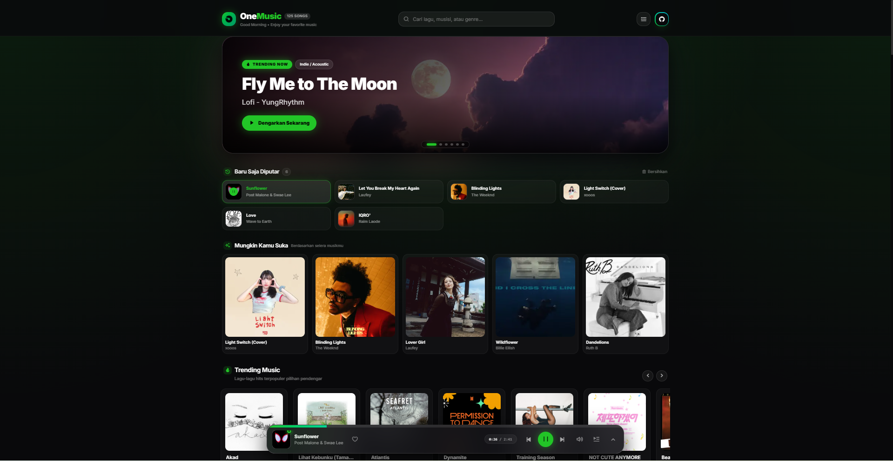
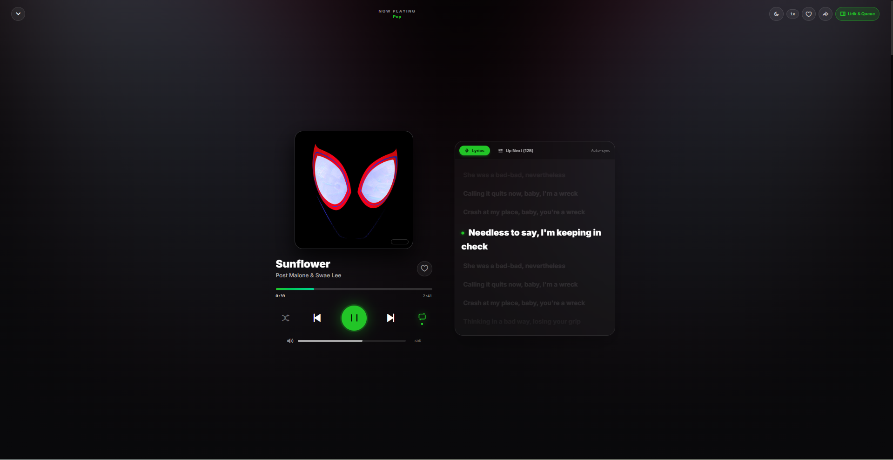
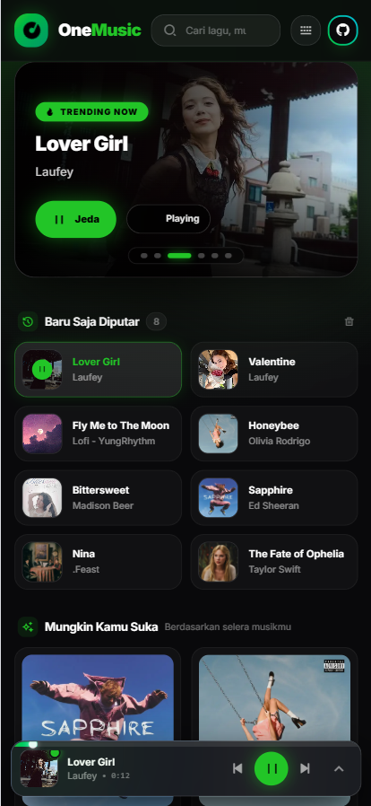
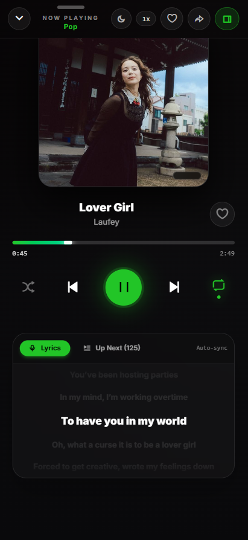

<div align="center">


Pemutar musik web dengan lirik tersinkronisasi, queue persisten, playlist personal, dan dukungan PWA.<br />
Dibangun dengan Next.js 16, React 19, dan Supabase.

<p>
  
  
  
  
  
</p>

<a href="https://next-app-music.vercel.app/">Live Demo</a> ·
<a href="https://github.com/mhdridwannst/OneMusic/issues">Laporkan Bug</a>

</div>

<br />

<div align="center">
  
</div>

## Tentang

OneMusic adalah aplikasi musik personal berbasis Next.js dan TypeScript. Antarmukanya gelap dengan gaya glassmorphism, kontrol pemutaran responsif, dan state yang tetap tersimpan antar sesi, termasuk queue, favorit, dan riwayat putar.

## Tampilan

### Desktop

<div align="center">
  <table>
    <tr>
      <td width="50%">
        
      </td>
      <td width="50%">
        
      </td>
    </tr>
    <tr>
      <td align="center"><sub>Beranda</sub></td>
      <td align="center"><sub>Full Player dengan lirik</sub></td>
    </tr>
  </table>
</div>

### Mobile

<div align="center">
  <table>
    <tr>
      <td width="50%" align="center">
        
      </td>
      <td width="50%" align="center">
        
      </td>
    </tr>
    <tr>
      <td align="center"><sub>Beranda dan Mini Player</sub></td>
      <td align="center"><sub>Full Player dengan lirik</sub></td>
    </tr>
  </table>
</div>

## Fitur

- Katalog lokal-first dengan sinkronisasi Supabase dan fallback.
- Play, pause, next, previous, shuffle, repeat, seek, volume, dan playback rate.
- Queue prioritas: tambah, hapus, ubah urutan, persistence, dan autoplay.
- Multiple personal playlists: create, rename, delete, add/remove lagu, dan ubah urutan.
- Guest playlist tersimpan lokal; akun Supabase menyinkronkan playlist ke cloud.
- Favorit, recently played, dan rekomendasi lagu.
- Pencarian berdasarkan judul, artis, atau genre.
- Lirik `.lrc` dengan highlight dan scroll otomatis.
- Deep link lagu lewat `?song=<id>` dan tombol share.
- Full Player, Mini Player, shortcut keyboard, serta state error audio dengan retry.
- UI responsive untuk desktop, tablet, dan mobile.
- PWA, metadata Open Graph, tema gelap, reduced motion, dan focus state.

## Tech stack

| Bagian           | Teknologi                                      |
| ---------------- | ---------------------------------------------- |
| Framework        | Next.js 16 (App Router)                        |
| UI               | React 19, Tailwind CSS 4, Framer Motion        |
| Bahasa           | TypeScript                                     |
| Data dan storage | Supabase PostgreSQL dan Supabase Storage       |
| Audio            | HTMLAudioElement, Media Session API            |
| PWA              | Web App Manifest dan production service worker |
| Hosting          | Vercel                                         |

## Arsitektur deployment

| Layanan  | Peran                                          |
| -------- | ---------------------------------------------- |
| GitHub   | Source code, cover, lirik, dan konfigurasi     |
| Supabase | Database katalog dan Storage untuk file MP3    |
| Vercel   | Build dan hosting aplikasi Next.js             |
| Browser  | Mengambil audio langsung dari Supabase Storage |

File MP3 tidak disimpan di GitHub. Folder `public/music/` diabaikan oleh Git agar repository tetap ringan. Saat development lokal, aplikasi membaca MP3 dari folder tersebut. Saat deployment, audio diarahkan ke Storage lewat `NEXT_PUBLIC_AUDIO_BASE_URL`.

## Menjalankan secara lokal

**Prasyarat:** Node.js 20.9+, npm, project Supabase, dan (opsional untuk development lokal) file MP3 di `public/music/`. Untuk menjalankan aplikasi tanpa koneksi database, katalog fallback tetap tersedia; audio production tetap membutuhkan URL Supabase Storage.

```bash
git clone https://github.com/mhdridwannst/OneMusic.git
cd OneMusic
npm install
```

Salin `.env.example` menjadi `.env.local` di root project, lalu ganti placeholder dengan nilai dari project Supabase lo:

```env
NEXT_PUBLIC_SUPABASE_URL=https://project-ref.supabase.co
NEXT_PUBLIC_SUPABASE_ANON_KEY=isi-dengan-publishable-key

# Opsional untuk deployment atau testing audio eksternal.
# Jangan tambahkan slash di akhir URL.
# NEXT_PUBLIC_AUDIO_BASE_URL=https://project-ref.supabase.co/storage/v1/object/public/music
```

`NEXT_PUBLIC_SUPABASE_ANON_KEY` aman dipakai di client sesuai policy Supabase. Jangan pernah memasukkan secret key atau service role key ke source code, browser, GitHub, atau variabel `NEXT_PUBLIC_*`.

```bash
npm run dev
```

Buka [http://localhost:3000](http://localhost:3000).

## Menyiapkan Supabase

### Tabel katalog

Jalankan di SQL Editor:

```sql
create table songs (
  id     bigint generated always as identity primary key,
  title  text not null,
  artist text not null,
  cover  text not null,
  src    text not null,
  lrc    text
);

alter table songs enable row level security;

create policy "Public read access"
  on songs for select
  using (true);
```

### Personal playlists dan authentication

Fitur playlist mendukung dua mode:

- **Guest:** playlist disimpan di `localStorage` browser.
- **Akun:** setelah user masuk melalui Supabase Auth, playlist disimpan di PostgreSQL dan dilindungi Row Level Security (RLS).

Jalankan SQL berikut satu kali melalui **Supabase Dashboard → SQL Editor**:

```text
supabase/migrations/20261117_personal_playlists.sql
```

Migration membuat tabel `playlists` dan `playlist_songs`, memberikan hak akses untuk role `authenticated`, serta memasang policy RLS agar setiap akun hanya dapat membaca dan mengubah playlist miliknya. `song_id` sengaja tidak memakai foreign key ke tabel `songs`, karena katalog aplikasi juga dapat memuat lagu dari `src/data/defaultSongs.ts`.

Setelah migration dijalankan:

1. Pastikan `NEXT_PUBLIC_SUPABASE_URL` dan `NEXT_PUBLIC_SUPABASE_ANON_KEY` sudah tersedia di `.env.local` dan Vercel.
2. Aktifkan Email provider di **Supabase → Authentication → Providers**.
3. Atur Site URL dan Redirect URLs di Supabase Authentication untuk domain lokal dan production.
4. Buka OneMusic, pilih **Masuk**, lalu buat akun atau login.

Saat pertama kali login, playlist guest yang tersimpan di browser akan dicoba diimpor ke akun tersebut. Jika belum menjalankan SQL migration, mode guest tetap dapat digunakan; fitur cloud akan menampilkan error sampai tabel dan RLS tersedia.

### Storage audio

1. Buka **Storage** di dashboard Supabase.
2. Buat bucket publik bernama `music`.
3. Pastikan ukuran setiap MP3 berada di bawah batas upload project.
4. Upload semua MP3 dengan script project (PowerShell):

```powershell
$env:NEXT_PUBLIC_SUPABASE_URL="https://project-ref.supabase.co"
$env:SUPABASE_SERVICE_ROLE_KEY="service-role-key-hanya-untuk-upload-lokal"
$env:SUPABASE_AUDIO_BUCKET="music"
npm run upload:audio
```

Script memakai `upsert`, jadi menjalankan ulang tidak membuat file duplikat. Service role key hanya dipakai sementara di terminal lokal dan tidak boleh di-commit.

URL audio publik berpola:

```text
https://project-ref.supabase.co/storage/v1/object/public/music/nama-file.mp3
```

## Validasi

Jalankan sebelum commit atau deploy:

```bash
npm run validate:catalog
npm run lint
npm run build
```

`validate:catalog` memeriksa ID, referensi audio yang duplikat, serta keberadaan cover dan lirik. Karena audio production disimpan di Supabase Storage dan folder `public/music/` tidak di-commit, pemeriksaan keberadaan MP3 lokal dilewati jika folder tersebut tidak tersedia. Saat ingin memvalidasi MP3 lokal secara eksplisit, jalankan `npm run validate:catalog -- --require-local-audio`. `npm run build` memastikan aplikasi bisa dikompilasi untuk production.

## Deploy ke Vercel

1. Import repository ke Vercel.
2. Tambahkan environment variable di **Settings → Environment Variables**:

   ```env
   NEXT_PUBLIC_SUPABASE_URL=https://project-ref.supabase.co
   NEXT_PUBLIC_SUPABASE_ANON_KEY=publishable-key
   NEXT_PUBLIC_AUDIO_BASE_URL=https://project-ref.supabase.co/storage/v1/object/public/music
   ```

3. Aktifkan untuk **Production** dan **Preview**.
4. Deploy atau redeploy.
5. Tes pemutaran beberapa lagu dan cek URL audio di Network panel browser.

> [!WARNING]
> Jangan tambahkan `SUPABASE_SERVICE_ROLE_KEY` ke Vercel. Key itu hanya untuk proses upload dari komputer lokal.

## Troubleshooting

**Lagu tidak bisa diputar setelah deploy**

- Pastikan bucket `music` bersifat publik.
- Pastikan `NEXT_PUBLIC_AUDIO_BASE_URL` tidak berakhir dengan slash.
- Pastikan nama object di Storage sama dengan nama file yang direferensikan.
- Pastikan environment variable diterapkan pada deployment yang benar, lalu redeploy.

**Upload berhenti pada satu file**

Periksa nama file. Gunakan karakter ASCII sederhana (huruf, angka, `-`, `_`, dan `.mp3`). Hindari emoji, tanda kurung siku, dan karakter Unicode khusus pada nama object Storage. Lalu jalankan ulang `npm run upload:audio`; file yang sudah ada akan di-update karena uploader memakai `upsert: true`.

## Struktur project

```text
src/
├── app/                  # App Router, layout, halaman, dan API
├── components/           # Komponen player dan UI
├── data/defaultSongs.ts  # Registry katalog lokal
├── hooks/                # State audio player
├── lib/audio.ts          # Resolver URL audio lokal/eksternal
└── types/                # TypeScript types
public/
├── images/               # Cover dan artwork
├── icons/                # Ikon PWA 192px, 512px, dan maskable
├── lyrics/               # File lirik .lrc
└── music/                # Audio lokal untuk development, diabaikan oleh Git
scripts/
├── upload-audio-to-supabase.mjs
└── validate-catalog.mjs
docs/                     # Screenshot untuk README
```

## Status

Fitur utama sudah tersedia: player, katalog, playlist, queue, PWA, validasi asset, dan audio eksternal di Supabase Storage. Belum ada automated test.

Rencana berikutnya:

- Automated UI testing
- Sinkronisasi akun
- Artwork yang lebih konsisten

## Kontribusi

Menemukan bug atau punya ide? Buat [issue di GitHub](https://github.com/mhdridwannst/OneMusic/issues).
